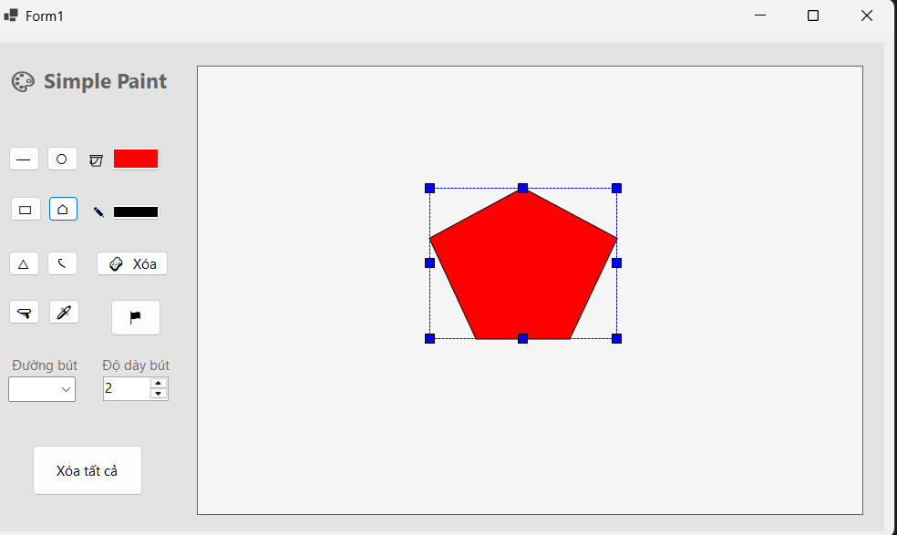

# 🎨 Simple Paint – Ứng dụng vẽ mini bằng C# Windows Forms

**Simple Paint** là ứng dụng vẽ đơn giản lấy cảm hứng từ Microsoft Paint, được phát triển bằng C# và Windows Forms. Ứng dụng cung cấp các công cụ vẽ hình cơ bản, tùy chỉnh màu sắc và chỉnh sửa hình vẽ thông qua giao diện trực quan, dễ sử dụng.

## 🎬 Video Demo

- **YouTube:** [Xem video demo Simple Paint](https://www.youtube.com/watch?v=6xdXSTliLDc)

## ✨ Tính năng chính

- ✏️ **Vẽ hình cơ bản:** Đường thẳng, hình chữ nhật, hình vuông, ellipse và hình tròn.
- 🔺 **Vẽ nâng cao:** Đa giác nhiều cạnh và đường cong.
- 🎨 **Tùy chỉnh màu sắc:** Chọn màu nét vẽ và màu nền.
- 📏 **Điều chỉnh nét vẽ:** Thay đổi độ dày nét theo nhu cầu.
- 🔄 **Chỉnh sửa hình vẽ:** Xóa, di chuyển, phóng to và thu nhỏ hình.
- 👆 **Giao diện trực quan:** Bố cục đơn giản, dễ thao tác.

## 🖼️ Giao diện ứng dụng

<p align="center">
  
</p>

## 💻 Công nghệ sử dụng

- **Ngôn ngữ:** C#
- **Framework:** .NET Windows Forms
- **Đồ họa:** GDI+ / `System.Drawing`
- **IDE:** Visual Studio 2022

## 🚀 Cách chạy chương trình

1. Clone repository về máy:

   ```bash
   git clone <URL_REPOSITORY>
   ```

2. Mở solution (`.sln`) bằng Visual Studio 2022.
3. Khôi phục các dependency nếu được yêu cầu.
4. Chọn cấu hình `Debug` hoặc `Release`.
5. Nhấn **F5** để chạy ứng dụng.

## 👨‍💻 Tác giả

**Minh Chương**  
Sinh viên Trường Đại học Sư phạm Kỹ thuật TP. Hồ Chí Minh.
